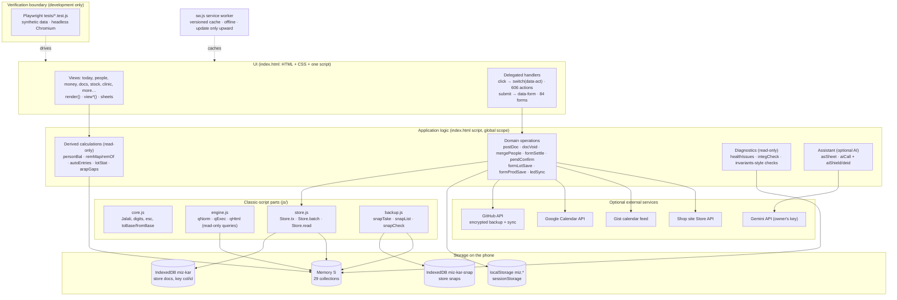

# Data and system architecture (as built, v4.45)

This describes the code as it is on `main` (`5dfabe5`), not an ideal design. Field-level detail is in [`../DATA.md`](../DATA.md); write path and Store internals in [`../ARCHITECTURE.md`](../ARCHITECTURE.md). Find any function with `node tools/q.js fn <name>`.

## 1. Architecture diagram

## 2. Module interaction matrix

Only boundaries the code confirms. All files share one global scope (classic scripts); "depends on" means calls globals defined there.

| Module / file | Responsibility | Owns | Reads | Writes | Depends on | Used by | Public contract | Coupling / risks |
|---|---|---|---|---|---|---|---|---|
| `js/core.js` | Jalali calendar, dates, Persian digits, escaping, money formatting | nothing | — | — | — | everything | `CORE_VER`, `fa`, `esc`, `toBase`, `fromBase`, `today`, Jalali helpers | stable, pure; reference outputs in `tests/fixtures/core-ref.json` |
| `js/engine.js` | read-only information engine | nothing | `S` (all collections) | — | core | assistant, «پرسش» | `ENGINE_VER`, `qNorm`, `qExec`, `qHtml` | pure reads; reference `engine-ref.json` |
| `js/backup.js` | automatic local copies | `miz-kar-snap` | `S` via `backupData()` | `miz-kar-snap` only | core, `Store.read` | start-up, restore, sync, delete | `BACKUP_VER`, `snapTake`, `snapList`, `snapGet`, `snapCheck`, `snapBoot` | independent DB; retention keeps newest daily + largest |
| `js/store.js` | persistence and atomicity | IndexedDB `miz-kar` write path | `S` (staged) | IndexedDB `docs`, `S` after commit | global `idb`, `mode`, `markDirty`, `UB` | every write in index.html | `STORE_VER`, `Store.tx`, `Store.batch`, `Store.read`, `Store.idle`, `Store.BUSY` | relies on index.html globals; cloud mode rejects `batch` |
| `index.html` — state & save | load, `save`/`putRaw`/`delRaw`, undo, tombstones | `S`, `meta/*` | IDB | via `Store` | store, core | all domains | `save(col,id,data,B)`, `putRaw(col,doc,B)`, `delRaw`, `delDoc` | the only write API; ordinary writes wait for an active operation that holds the record |
| `index.html` — money | ledger rows, settle, receipts, recurring, vouchers | `ledger`, `vouchers`, `recurs`, `cheques` | people, docs, lots | ledger etc. via save/batch | Store | people, docs, stock, clinic, reports | `formSettle`, `pendConfirm`, `ledSync`, `ledReopen`, `personBal`, `remMap`, `remOf` | net vs per-row calculations must agree (ARAP); `settled` is a stored flag |
| `index.html` — documents | invoices, purchases, returns, proformas, letters, contracts, count, production | `docs` | people, lots, ledger | docs + postings (lots, moves, ledger) | money, stock, Store | people, reports | `formDoc`, `formDocSave`, `postDoc`, `docVoid`, `docLinked`, `docHtml` | posting is atomic; versions via `redoOf` |
| `index.html` — stock | lots, moves, packing, stock count | `lots`, `moves` | docs, ledger | lots/moves (+ payables) | money, Store | documents, reports | `formLot`, `formLotSave`, `lotStat`, `lotCost`, `formProdSave` | stock value must equal account 1301 |
| `index.html` — accounting | derived double entry, statements | nothing (derived) | ledger, moves, lots, vouchers | — | money, stock | money tab, reports, diagnostics | `autoEntries`, `balancesByAcc`, `glBal`, `stmtRows` | computed on read; never stored |
| `index.html` — people / CRM | persons, roles, merge, stay-in-touch | `people`, `contacts` | all linked rows | people (+ relinks) | Store | all | `mergePeople`, `viewPerson`, `balances` | two person stores (`people`, `contacts`) |
| `index.html` — clinic | cases, visits, fees | `cases`, `visits` | people, ledger | cases, visits, fee rows (`visitOf`) | money | person timeline, AI (de-identified) | `clinicSheet` and visit forms | DEC-1 (fee row when a visit is deleted) |
| `index.html` — tasks / calendar | tasks, meets, unified calendar | `tasks`, `meets` | many | tasks | — | today, calendar, follow-ups | `mcal`, `recvReopen`, `recvTid` | follow-up tasks derived from receivables |
| `index.html` — sync & backup UI | file/cloud backup, restore, sync, conflicts | `meta/tomb`, `meta/conflicts` | all | all (restore, sync) | Store, backup.js, GitHub | backup page | `backupData`, `applyData`, `restoreApply0`, `syncMerge`, `confPick`, `ghPush0`, `ghSync` | all atomic (`Store.batch`); cloud mode refuses |
| `index.html` — diagnostics | health, data integrity | nothing | all | — (read-only) | calculations | settings | `healthIssues`, `integCheck`, `integSheet`, `integText`, `integGo` | read-only by test 68 |
| `sw.js` | offline cache, install, update | Cache Storage | network | caches | — | the page | `SHELL`, `PARTS`, versioned cache `miz-kar-v<ver>` | install is all-or-nothing; only upward updates |
| `tools/` | developer tools | — | repo files | repo files (version only) | Node | developers | `q.js`, `version.js` | never loaded by the app |

**Global state:** `S` (all collections in memory), `mode` (`local` / `cloud` = in-Claude view), `idb`, `UB` (undo), `GH`/`GC` configs, UI state `ui`, `tab`. **Action dispatching:** one delegated click handler with `switch(a)` on `data-act`, one delegated submit handler on `data-form` (a second submit of the same form is ignored while the first runs, `data-busy`). **Remaining monolith:** almost all domain logic is in `index.html` (~6,400 lines, 788 functions); `node tools/q.js map` prints its regions. **Known duplicate logic** (from `../BACKLOG.md` «Known structural facts»): money in three shapes (ledger rows, vouchers, document effects); two person stores; two calendar outputs; ~200 empty `catch(_){}`.

## 3. Key workflows end to end

| Workflow | Path | Atomic? | Guards |
|---|---|---|---|
| Sale / purchase invoice | `formDoc` → submit → `formDocSave` (one doc id per form, `data-nid`) → `postDoc` → `Store.batch('post:<id>')`: lots, moves, ledger rows, `posted:true` | yes (local) | double-submit lock, `posted` flag, `Store.BUSY` |
| Edit an invoice | new version with `redoOf` → old version voided → new posted; payments follow (`LEG_SET`) | yes | `docSuccessor` / `docLiveAncestor` refuse two live versions |
| Void / restore a document | `docVoid` → `Store.batch` over `docLinked` | yes | `docVoidDone` (idempotent) |
| Purchase from stock-in form | `formLot` → `formLotSave` → `Store.batch('lot:…')` → `formLotSave0` (lot + payable + packing + `ledSync`) | yes (local); sequential in cloud | test 71/76 |
| Payment / receipt | ledger form or `formSettle` (payment with `refId`, row `settled` when covered) | single writes | `ledSync` keeps `settled` right after edits (4.42) |
| Bank SMS → confirm recurring payment | `receiptSheet` → `rcptPend` → `pendConfirm` (row + pair + bank ref, `rcpt` key) | yes | one message → one live row |
| Edit a ledger row | `formLedgerEditSave` → `Store.batch('ledEdit:<id>')`: row, payments that follow it, `ledSync`, `recvReopen` | yes (local) | hand-settled rows never reopened |
| Clinic visit with fee | visit form → visit record + fee row (`visitOf`); paid now → settled | single writes | DEC-1 pending |
| Merge people | `mergePeople` → `Store.batch` relinks every row, `mergedInto` | yes | idempotent |
| Backup | file (`backupData`), encrypted second copy, encrypted cloud (`ghPush0`), Excel, printed recovery sheet, automatic snapshots | reads via `Store.read` | snapshot before risky actions |
| Restore | preview → `restoreApply0` / `applyData` in `Store.batch('apply')` | yes | snapshot first; failure → nothing changed; `allowShrink` only after success |
| Sync (GitHub) | `ghSync` → `syncMerge` in `Store.batch` (quiet), tombstones, conflicts → `confPick` | yes | `cloudBlock` on unusual shrink; conflicts never auto-resolved |

## 4. Storage, keys and schema

- **IndexedDB `miz-kar`**, version 1, one object store `docs`, records `{k:'<col>/<id>', col, doc}`; no indexes (everything is loaded into `S` at start). 29 collections = `COLS` = keys of `S` (listed in [`../DATA.md`](../DATA.md) §1, checked by test 05).
- **IndexedDB `miz-kar-snap`**, version 1, store `snaps` (`{id, at, reason, n, counts, h, ver, txt}`), 10 copies (5 when storage > 80 %).
- **localStorage `miz.*`**: settings, UI filters (`miz.uiF`), drafts, trash, counters; excluded from backups (`LS_SKIP`): `miz.gh`, `miz.ai`, `miz.lic`, `miz.dev`, `miz.devid`, `miz.unsent`, `miz.cnt`, `miz.seenVer`, `miz.onb`, `miz.tab`, `miz.seeded`. **sessionStorage**: Google sign-in token.
- **Schema versions / migrations:** no structural migration has ever run (schemaless documents, IDB v1). Data changes happen only through start-up jobs (`bootJobs`, e.g. category migration) with history. Any future migration needs a reviewed plan, a backup, a verification and the owner's approval ([`../RELEASE.md`](../RELEASE.md) §6).
- **Ownership:** each collection has one owning domain (matrix above); cross-domain writes go through that domain's functions or `Store.batch` operations.
- **Authoritative sources:** [`../DATA.md`](../DATA.md) §2 (balances, stock, document effects are always derived on read; the only stored derived flag is `settled`).

## 5. Business invariants and rules

Formulas behind these invariants (balances, open rows, postings, stock cost, reports) are in [CALCULATION_RULES.md](CALCULATION_RULES.md).

Enforced by `tests/lib.js` `invariants()` in every money/stock test and reported by `integCheck()` on the phone:

1. Trial balance: Σ debit = Σ credit (toman).
2. Σ person balances = receivables (1201) − payables (2101).
3. Stock value (Σ remaining × cost) = inventory account 1301. Known exception by design: stock-in «در حساب‌ها ثبت نشود» (DEC-2).
4. No two live versions of one document; postings of a void document are void.
5. Per person: net balance (`personBal`) = Σ open receivables − Σ open payables (`remOf`) + prepayment/overpayment (`arapGaps`).
6. One bank message (`rcpt`) confirms at most one live row.

**Rounding:** amounts are stored in toman; input in million toman via `toBase` (×1e6, rounded to 0.1 toman); "open" means > 0.5 toman; small balances (< 1,000 toman) are reported (TINY-1), never written off automatically (DEC-3). **Currency:** invariants and aging are toman-only; other currencies are kept per row.

**Duplicate prevention:** form submit lock (`data-busy`, no expiry), one new document per form (`data-nid`), operation keys (`Store.BUSY`), idempotent flags (`posted`, `mergedInto`, `docVoidDone`), receipt keys (`rcpt`), duplicate warnings (`dupGuard`).

**Failure handling:** inside `Store.batch` any error rolls back memory and undo exactly and writes nothing; outside it each write is its own transaction (memory changes only after commit). Cloud mode has no multi-record transaction: multi-record operations and deletes are refused (production, count, posting, merge, restore, sync); lot save and ledger edit run sequentially there (documented limitation).

## 6. Domains covered (implemented)

Persian RTL UI with Jalali calendar and Hijri dates for worship; offline PWA with versioned cache and upward-only updates; snapshots, backup and recovery; people/CRM (roles, stay-in-touch, merge, timeline); tasks, inbox, weekly review, regular meetings, unified calendar, Google Calendar; money (accounts, receipts from bank SMS, recurring payments, cheques, vouchers, statements, closing the year); documents (invoice, purchase, returns, proforma, letter, contract, count, production) with print and share; stock (lots, packing, moves, count); deals, quotes, campaigns, commission (referral); clinic (cases, visits, protocols, de-identified AI); apiary; trips; vault (PIN, biometric) and assets; worship (prayers, fasting, Quran research, kinship, charity); assistant and information engine; licence/activation; diagnostics. Details per domain: [FUNCTIONAL_SPECIFICATION.md](FUNCTIONAL_SPECIFICATION.md).

## 7. External integration boundaries

Every path below starts only after the owner switched it on (token, key or setting on the phone). Verified in the code on 2026-11-06.

| Path | Entry | Data that leaves | Destination | Protection | Main risk |
|---|---|---|---|---|---|
| GitHub backup | `ghPush0` → `ghPack` | the full data set (`backupData`), whole | a private repository the owner names (`api.github.com/repos/…/contents`) | AES-GCM with a key from the owner's passphrase (random salt and IV per upload); **no passphrase → nothing is sent** (`GH_NOPASS`); shrink guard (`cloudBlock`) | a weak or lost passphrase; the token and passphrase are stored with the GitHub settings in `localStorage` `miz.gh` on the phone (not in backups) |
| Device sync | `ghSync` → `syncMerge` | same encrypted snapshot per device | same repository | as above; `vault/bio`, `meta/tomb`, `meta/conflicts` are never synced | wrong merges are prevented by conflicts (§7a), not by encryption |
| Calendar feed (gist) | `calPush` → `calFeed` | **readable** .ics: open task titles and dates, the person's name for tasks and for receivable/payable due dates («سررسید طلب از …»), occasions; no amounts. Clinic items get generic titles (no name, phone, note or case code), and clinic tasks only when `calClinic` is on | a **secret** (unlisted) gist, `public:false`, read by Google Calendar through its raw URL | none beyond the secret URL; `scr()` scrubs text | anyone with the URL can read it; deleting the gist (`gistDelete`) stops it |
| Google Calendar | `gcSync` → `gcItems` | **readable** events: task titles/descriptions, deal next steps, meeting place and member count, receivable/payable and cheque due items with the person's name; **amounts only when «noAmt» is switched off** (default: no amounts); names hidden when «noName» is on; clinic items only when `calClinic` is on | the owner's Google account (`googleapis.com/calendar/v3`) | OAuth token for the session; owner options above | Google holds names and dates in readable form |
| Gemini | `aiCall` (always `aiShield`); clinical text also `deid` | the owner's sentence or question; de-identified clinical text and case summary (code, not name); **photos** for field extraction (receipts, documents) as images | `generativelanguage.googleapis.com` with the owner's key | `aiShield` replaces clinic clients' names with «مراجع»; `deid` removes names, relatives and identifiers; images are **not** de-identified | text outside clinic names is sent as written; an image may show names or numbers |
| Shop site (WooCommerce Store API) | `syncCatalog` | none (GET) | the shop site | CSP allows exactly two origins | site CORS **not verified** (SITE-1) |
| Update check | `checkUpdate` → `version.json` | none | GitHub Pages | — | — |

[OPEN] Whether the owner wants names in the calendar feed by default is not recorded as a decision; the current behaviour is kept.

### 7a. Device sync rules (`syncMerge0`, verified)

- Duplicates in the incoming payload: the newest copy wins.
- Tombstones: an older remote copy of a deleted record is skipped. Records already in an open conflict are skipped.
- New records are added.
- **First sync** (no `last`): every differing copy becomes a conflict.
- A newer remote copy is applied, unless the local copy also changed since `last`; then it becomes a conflict.
- Remote deletions are applied, unless the record changed locally since the last sync, or the device never synced; then it becomes a conflict.
- The whole merge runs in one `Store.batch('sync', …)`.
- People and duplicates are never merged automatically; merging people is a separate manual action (`mergePeople`).

The CSP (`index.html` `<meta http-equiv="Content-Security-Policy">`) lists every allowed origin; the service worker handles same-origin requests only.

## 8. External observer / integrity monitoring

**Exists today (in the app, read-only):**
- `integCheck()` / `integSheet()` / `integText()` («تنظیمات ← عیب‌یابی داده‌ها»): books, D1 document versions (dated by `d1When()`), orphan postings, stock of void lots, negative lots, broken links, settled-state mismatches (`ledSuspect()`), tiny balances, duplicate receipts, unreadable records; every finding opens its record (`integGo()`); no names, amounts or clinical text; nothing written (test 68 counts writes).
- `healthIssues()` (data-quality hints with fix buttons — the user acts, not the checker).
- Test-side `invariants()` (development only).

**Proposed, not implemented (staged):**

| Stage | What | Rules |
|---|---|---|
| O1 | Formal finding format: `{id, severity: confirmed-defect / warning / anomaly, rule, evidence (record keys, values), reproducible query}`; versioned rule list in one place | read-only; same rules on phone and in tests |
| O2 | Run the observer on a backup file outside the app (Node script over the JSON backup) so findings can be reviewed without touching the phone | consumes a copy; never writes back |
| O3 | Backup / restore / sync integrity: compare counts and hashes of the last snapshot, the file backup and the cloud copy; report drift | read-only |
| O4 | Repair proposals only: each finding may suggest an action that the owner performs through the normal app service (e.g. `docVoid`, `formSettle`) with history | no automatic financial adjustment; explicit per-case authorisation |

Hard rules for every stage: the observer never modifies, deletes, reconciles or "corrects" data; it is not a second source of truth (it recomputes from the same records); findings are traceable to record keys; access is read-only by default.

## 9. AI boundary (current and future)

- **Current:** AI is optional and outside the source of truth. Gemini only extracts intent (assistant) or phrases answers; numbers and records come from local code (`qExec`). Clinical text is de-identified first; names are removed from questions. Every consequential result goes through a normal form the user submits.
- **Future (controlled):** a provider-independent `aiCall` interface; capabilities as explicit read-only tools over the information engine; write capabilities only as *proposals* rendered into normal forms; data minimisation per request; local operation unchanged when AI is unavailable. No infrastructure is to be built for this until a concrete approved need.
